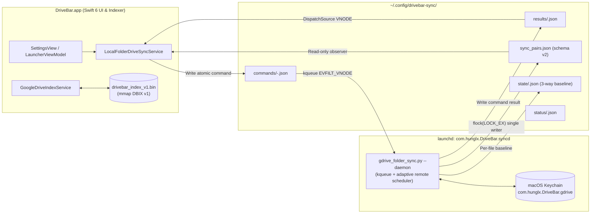

# DriveBar Sync & Binary Index Architecture (`v2.0.0`)

This document describes the architecture, data-safety invariants, and performance design of DriveBar's **Local Folder ↔ Google Drive Sync Engine** (`Resources/gdrive_folder_sync.py` + `LocalFolderDriveSyncService.swift`) and **Memory-Mapped Binary Index Engine** (`GoogleDriveIndexService.swift`).

---

## 1. System Overview



---

## 2. Single-Writer Configuration & Command Queue (`~/.config/drivebar-sync`)

To eliminate lost-update races between the Swift app, Finder Quick Actions, and the background Python daemon, **only `gdrive_folder_sync.py` writes `sync_pairs.json`** under an exclusive file lock (`fcntl.flock(LOCK_EX)` on `sync_pairs.lock`).

### 2.1. `sync_pairs.json` (Schema v2)
Contains lightweight pair configuration and summary status only (`knownRelativeFiles` is never stored inside `sync_pairs.json` or `UserDefaults`):

```json
{
  "schemaVersion": 2,
  "updatedAt": 1763200000.0,
  "pairs": [
    {
      "id": "E278E67D-...",
      "localPath": "/Users/hunglx/Documents/antigravity/ProjectA",
      "driveTargetPath": "/Users/hunglx/Library/CloudStorage/GoogleDrive-user@domain/My Drive/00. Antigravity_Sync/ProjectA",
      "syncMode": "two_way_mirror",
      "isEnabled": true,
      "status": "ok",
      "lastSyncedAt": 1763200000.0,
      "lastSyncFileCount": 142,
      "lastSyncTotalBytes": 18452910,
      "pendingDeletionPlan": null,
      "lastConflicts": []
    }
  ]
}
```

### 2.2. Command Channel (`commands/` → `results/`)
When `LocalFolderDriveSyncService` or a Finder Quick Action adds, updates, removes, toggles, or confirms a pair, it writes an atomic command file to `~/.config/drivebar-sync/commands/<epoch_ms>-<cmdId>.json`:
- Supported operations (`op`): `add`, `update`, `remove`, `enable`, `disable`, `sync`, `resolve_confirmation`, `set_share`.
- The daemon wakes immediately via `kqueue` (`EVFILT_VNODE` on `commands/`), processes commands in timestamp order under `sync_pairs.lock`, writes `~/.config/drivebar-sync/results/<cmdId>.json`, and unlinks the command file.

---

## 3. Data-Safety Invariants

### 3.1. Mount Health Verification & Mass-Deletion Guard
Before planning any deletion in `two_way_mirror` mode:
1. **Mount Health Check (`check_mount_health`)**:
   - Verifies that both `localPath` and `driveTargetPath` exist and are accessible directories.
   - For paths under `~/Library/CloudStorage/GoogleDrive-*`, verifies the mount root exists, is `os.R_OK | os.X_OK`, and has a non-empty `My Drive` or `Shared drives` directory.
   - If a previously synced side (`baseline.files > 0`) now scans `0` files (`empty_side_after_prior_sync`), sync aborts immediately with `status = "needs_confirmation"` and **zero deletions**.
2. **Deletion Ratio Guard (`check_deletion_guard`)**:
   - Triggers when `planned_deletes >= 5` and `planned_deletes / baseline_count > 0.20`, or when `planned_deletes >= 25`.
   - Sets `pair.status = "needs_confirmation"` and populates `pendingDeletionPlan` so the user can choose **"Restore from other side"** (`restore_from_other`) or **"Apply deletions"** (`apply_deletions`) in `SettingsView`.

### 3.2. 3-Way Baseline State & Non-Destructive Conflict Copies
Per-pair baseline state is persisted at `~/.config/drivebar-sync/state/<pairId>.json`:

```json
{
  "schemaVersion": 2,
  "lastSyncedAt": 1763200000.0,
  "files": {
    "docs/report.docx": {
      "localMtime": 1763199000.12,
      "driveMtime": 1763199000.12,
      "size": 48210,
      "sha256": null
    }
  }
}
```

For each relative file path `rel` across `L` (Local), `D` (Drive), and `B` (Baseline):
- **Both `L` and `D` exist**:
  - `L == B` and `D == B`: No-op.
  - `L != B` and `D == B`: Copy `L -> D`, update `B`.
  - `L == B` and `D != B`: Copy `D -> L` (unless `D` is `SF_DATALESS`), update `B`.
  - `L != B` and `D != B`:
    - If `size` and `SHA-256` match: converge `B` without copying.
    - Otherwise: **True 3-way conflict**. The newer file wins the canonical path, and the losing version is preserved on **both** sides as `<stem> (Conflict <host> <YYYY-MM-DD HHMMSS>)<ext>`.
- **Only `L` exists (`D` missing)**:
  - `rel not in B`: New local file → copy `L -> D`.
  - `rel in B` and `L == B`: Deleted on Drive → trash `L` (subject to mass-deletion guard).
  - `rel in B` and `L != B`: Modified locally while deleted on Drive → **keep `L`** and re-upload `L -> D`.
- **Only `D` exists (`L` missing)**:
  - `rel not in B`: New Drive file → copy `D -> L`.
  - `rel in B` and `D == B`: Deleted locally → trash `D` (subject to mass-deletion guard).
  - `rel in B` and `D != B`: Modified on Drive while deleted locally → **keep `D`** and restore `D -> L`.

---

## 4. Event-Driven Daemon & `launchd` Lifecycle

### 4.1. `LaunchAgent` (`~/Library/LaunchAgents/com.hunglx.DriveBar.syncd.plist`)
- Managed by `LocalFolderDriveSyncService` via `launchctl bootstrap` / `kickstart -k`.
- Configured with `RunAtLoad = true`, `KeepAlive = true`, `ProcessType = Background`, `LowPriorityIO = true`.
- Logs to `~/Library/Logs/DriveBar/syncd.log`.
- OAuth credentials (`access_token`, `refresh_token`, `client_secret`) are stored in macOS Keychain under service `com.hunglx.DriveBar.gdrive` (`security find-generic-password` / `add-generic-password -U`), with automatic one-time migration from `~/.config/drivebar-sync/gdrive_oauth.json`.

### 4.2. `kqueue` Event Loop & Adaptive Remote Folder Polling
- Watches `commands/`, `trigger.flag`, and top-level local/Drive pair directories via `select.kqueue()` (`EVFILT_VNODE`), debouncing filesystem bursts by `1.5 s`.
- Full safety reconciliation runs only every `300 s` (`5 min`) instead of `3 s` polling.
- For `remote_shared_link` pairs:
  - Uses exponential backoff (`120 s` → `300 s` → `600 s` → `900 s` max) when no remote changes occur.
  - Performs a lightweight single-request `files.list(..., pageSize=1, orderBy="modifiedTime desc")` probe against `lastRemoteLatestModifiedTime` before traversing the recursive folder tree.
  - Skips downloading files whose remote `md5Checksum` + `size` match the local file's cached digest.

---

## 5. Single-Pass Parallel Indexer & Memory-Mapped Binary Cache (`drivebar_index_v1.bin`)

### 5.1. Single-Pass Parallel POSIX `fts_open` Scanner
`GoogleDriveIndexService` scans each root (`My Drive`, `Shared drives`, local home folders, and custom Mac folders) **once** in parallel via `withTaskGroup`, emitting both `DriveFolderEntry` and `DriveFileEntry` records from a single `fts_read` pass and pruning noisy build directories (`.git`, `node_modules`, `__pycache__`, `.build`, `.venv`, `DerivedData`, etc.) via `fts_set(..., FTS_SKIP)`.

### 5.2. Packed Binary Index Format (`DBIX` v1)
All four indices (`FastFolderIndex`, `FastSharedIndex`, `FastFileIndex`, and `fastMacFolderIndex`) are stored in a single contiguous binary file at `~/.config/alfred-scripts/drivebar_index_v1.bin` and loaded with `Data(contentsOf:options:.alwaysMapped)`:
- **52-byte Header**: Magic `"DBIX"`, version `1`, creation timestamp, and `(offset, byteCount)` descriptors for `rootsData`, `folderBlob`, `sharedBlob`, `fileBlob`, and `macBlob`.
- **Sorted Record Table**: Each index blob begins with `[count: UInt32, offsets: [UInt32]]` sorted lexicographically by UTF-8 path, enabling:
  - **O(log N) binary search** for `containsPath(_:)`, `isDir(forPath:)`, and `children(ofParent:)`.
  - **Zero per-record heap allocations** and **zero ARC `swift_retain`/`swift_release` traffic** during search: `evaluateMyDriveSearchHits`, `evaluateSharedSearchHits`, `evaluateFileSearchHits`, and `evaluateMacFolderSearchHits` scan raw UTF-8 byte slices directly inside `blob.withUnsafeBytes` and decode `String` values only for the top `K` (`maxResults = 45`) winning hits.
- **Alfred Compatibility**: When `AppSettings.shared.keepAlfredCacheCompatible` is enabled (default `true`), `folder_cache.json` and `shared_cache.json` are written asynchronously at `.background` priority debounced by `30 s`.
