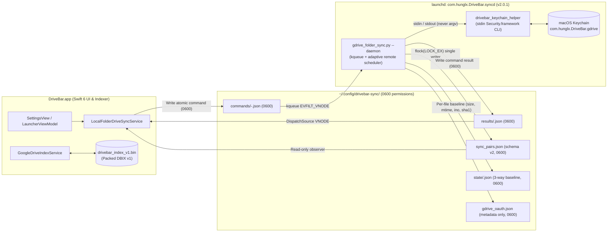

# DriveBar Sync & Binary Index Architecture (`v2.0.1`)

This document describes the architecture, data-safety invariants, security hardening, and performance design of DriveBar's **Local Folder ↔ Google Drive Sync Engine** (`Resources/gdrive_folder_sync.py` + `Resources/drivebar_keychain_helper.swift` + `LocalFolderDriveSyncService.swift`) and **Packed Binary Index Engine** (`GoogleDriveIndexService.swift`).

---

## 1. System Overview



---

## 2. Single-Writer Configuration, File Permissions & Command Queue (`~/.config/drivebar-sync`)

To eliminate lost-update races between the Swift app, Finder Quick Actions, and the background Python daemon, **only `gdrive_folder_sync.py` writes `sync_pairs.json`** under an exclusive file lock (`fcntl.flock(LOCK_EX)` on `sync_pairs.lock`).

### 2.1. Strict `0600` File Permissions & Secret Isolation
- `write_json_atomic(target_path, payload, indent=2, mode=0o644)` creates its temporary file via `os.open(tmp_path, os.O_WRONLY | os.O_CREAT | os.O_EXCL, mode)` and enforces `os.fchmod(fd, mode)` + `os.fsync(fd)` before `os.replace(tmp_path, target_path)`.
- All sensitive state and IPC files are written with `mode=0o600`:
  - `~/.config/drivebar-sync/gdrive_oauth.json`
  - `~/.config/drivebar-sync/sync_pairs.json`
  - `~/.config/drivebar-sync/state/<pairId>.json`
  - `~/.config/drivebar-sync/commands/<cmdId>.json`
  - `~/.config/drivebar-sync/results/<cmdId>.json`
  - `~/.config/drivebar-sync/last_sync_result.json`
- On daemon startup (`enforce_secret_file_permissions()`), any existing `gdrive_oauth.json`, `sync_pairs.json`, or `state/*.json` with permissions wider than `0600` is immediately tightened to `0600`.
- **Keychain via `stdin` (`drivebar_keychain_helper`)**:
  - OAuth secrets (`access_token`, `refresh_token`, `client_secret`) are stored in macOS Keychain under service `com.hunglx.DriveBar.gdrive` using the compiled Swift helper `drivebar_keychain_helper` (`Security.framework`: `SecItemAdd`, `SecItemUpdate`, `SecItemCopyMatching`, `kSecAttrAccessibleAfterFirstUnlockThisDeviceOnly`).
  - Secrets are piped to `drivebar_keychain_helper write` via **`stdin`** (`subprocess.run(..., input=serialized.encode("utf-8"))`), never passed on `argv` where `ps` could observe them.
  - Legacy items previously created by `/usr/bin/security` are automatically migrated on read (`_keychain_read_json` reads fallback stdout, re-writes via `drivebar_keychain_helper`, verifies read-back, and removes the old item).

### 2.2. `sync_pairs.json` (Schema v2)
Contains lightweight pair configuration and summary status only (`knownRelativeFiles` is never stored inside `sync_pairs.json` or `UserDefaults`):

```json
{
  "schemaVersion": 2,
  "updatedAt": 1763200000.0,
  "pairs": [
    {
      "id": "E278E67D-...",
      "localPath": "/Users/hunglx/Documents/antigravity/ProjectA",
      "driveTargetPath": "/Users/hunglx/Library/CloudStorage/GoogleDrive-user@domain/My Drive/00. Antigravity_Sync/ProjectA",
      "syncMode": "two_way_mirror",
      "isEnabled": true,
      "status": "ok",
      "lastSyncedAt": 1763200000.0,
      "lastSyncFileCount": 142,
      "lastSyncTotalBytes": 18452910,
      "pendingDeletionPlan": null,
      "lastConflicts": [],
      "deferredFiles": []
    }
  ]
}
```

### 2.3. Command Channel (`commands/` → `results/`)
When `LocalFolderDriveSyncService` or a Finder Quick Action adds, updates, removes, toggles, or confirms a pair, it writes an atomic `0600` command file to `~/.config/drivebar-sync/commands/<epoch_ms>-<cmdId>.json`:
- Supported operations (`op`): `add`, `update`, `remove`, `enable`, `disable`, `sync`, `resolve_confirmation`, `set_share`.
- The daemon wakes immediately via `kqueue` (`EVFILT_VNODE` on `commands/`), processes commands in timestamp order under `sync_pairs.lock`, writes `~/.config/drivebar-sync/results/<cmdId>.json` (`0600`), and unlinks the command file.

---

## 3. Data-Safety Invariants

### 3.1. Mount Health Verification & Mass-Deletion Guard
Before executing any deletion in `two_way_mirror` mode:
1. **Mount Health Check (`is_drive_mount_healthy`)**:
   - Verifies that both `localPath` and `driveTargetPath` exist, are accessible directories, and that any Google Drive mount root under `~/Library/CloudStorage/GoogleDrive-*` has a valid device ID and readable entries.
   - **Empty-Side Guard**: If a previously synced side (`baseline_count > 0`) now scans `0` files (`local_count == 0` or `drive_count == 0`), sync aborts immediately with `status = "needs_confirmation"` (`reason = "local_empty_unexpectedly"` or `"drive_empty_unexpectedly"`) and **zero deletions**.
2. **Deletion Threshold Guard (`should_block_mass_deletion`)**:
   - Computes `threshold = max(DRIVEBAR_DELETE_MIN_COUNT, int(DRIVEBAR_DELETE_MAX_RATIO * baseline_count))` where `DRIVEBAR_DELETE_MIN_COUNT = 20` (default) and `DRIVEBAR_DELETE_MAX_RATIO = 0.20` (`20%`).
   - Triggers when `len(planned_deletions) >= max(20, int(0.20 * baseline_count))`.
   - Sets `pair.status = "needs_confirmation"` and populates `pendingDeletionPlan` so the user can choose **"Khôi phục từ phía còn lại / Restore from other side"** (`restore`) or **"Xác nhận xóa / Apply deletions"** (`delete_all`) in `SettingsView`.

### 3.2. 3-Way Baseline State (`state/<pairId>.json`)
Per-pair baseline state is persisted at `~/.config/drivebar-sync/state/<pairId>.json` (mode `0600`):

```json
{
  "version": 2,
  "pairId": "E278E67D-...",
  "updatedAt": 1763200000.0,
  "files": {
    "docs/report.docx": {
      "size": 48210,
      "mtime": 1763199000.12,
      "localIno": 12948102,
      "sha1": "3a7bd3e2360a3d29eea436fcfb7e44c735d117c4"
    }
  }
}
```

- **Baseline Fields**:
  - `size`: File byte count at last sync.
  - `mtime`: Effective modification timestamp (`max(local.mtime, drive.mtime)` when converged).
  - `localIno`: Local POSIX inode (`st_ino`).
  - `sha1`: Hex SHA-1 digest computed and persisted for materialized files `<= 64 MB` (`SHA1_BASELINE_MAX_BYTES = 64 * 1024 * 1024`); `null` for files `> 64 MB` or dataless placeholders. When a file's `mtime` changes (e.g., via `touch`) without content modification, or when both sides have matching `size` and `file_sha1()`, the engine converges the baseline without redundant copying.

### 3.3. Dataless (`SF_DATALESS`) Materialization & Deferred Safety
Google Drive for Desktop online-only placeholder files carry the macOS `SF_DATALESS` (`0x40000000`) flag in `st_flags`. Reading or overwriting a dataless placeholder without materializing it first can lose remote edits. DriveBar enforces three rules:
1. **Never overwrite, trash, or record a new baseline** for a path whose Drive side is `SF_DATALESS` when the sync decision depends on Drive content (3-way conflict, `Drive -> Local` copy, legacy two-side reconciliation, or identical-content check).
2. **Materialize First (`materialize_dataless(path, timeout=60.0, max_bytes=512MB) -> bool`)**:
   - Opens and reads the Drive file in `1 MB` chunks to trigger Google Drive for Desktop hydration, bounded by a per-file timeout (`DRIVEBAR_MATERIALIZE_TIMEOUT_SEC = 60 s`), a per-run budget (`DRIVEBAR_MATERIALIZE_BUDGET_SEC = 300 s`), and a configurable file size cap (`DRIVEBAR_MATERIALIZE_MAX_BYTES = 512 MB`).
   - Re-runs `os.lstat()` after reading and verifies `SF_DATALESS` is cleared before proceeding.
3. **Defer on Hydration Failure/Timeout**:
   - If materialization fails or times out, the relative path is added to `deferred` (`pair.deferredFiles`), its **existing baseline entry `bm` is preserved unchanged** in `new_base_files`, and neither side is modified.
   - `SettingsView` displays `"⏳ N tệp đang chờ tải từ Drive / ⏳ N files waiting for Drive download"`.
4. **Non-Destructive Conflict Copies**:
   - When both sides changed (`l_chg and d_chg`) and differ in content after materialization, conflict copies are always created from real materialized content on **both** sides (`<stem> (Conflict <from>-<host> <YYYYMMDD-HHMMSS>)<ext>`) before updating the canonical path.

---

## 4. Event-Driven Daemon & Measured CPU

### 4.1. `LaunchAgent` (`~/Library/LaunchAgents/com.hunglx.DriveBar.syncd.plist`)
- Managed by `LocalFolderDriveSyncService` via `launchctl bootstrap` / `kickstart -k`.
- Configured with `RunAtLoad = true`, `KeepAlive = true`, `ProcessType = Background`, `LowPriorityIO = true`.
- Logs startup and sync events to `~/Library/Logs/DriveBar/syncd.log` (`DriveBar syncd v2.0.1 started (pid=...)`).

### 4.2. `kqueue` Event Loop & Measured CPU Usage
- Watches `commands/`, `trigger.flag`, and synced local/Drive directories via `select.kqueue()` (`EVFILT_VNODE`), debouncing filesystem bursts by `1.5 s`.
- Safety reconciliation runs every `300 s` (`5 min`).
- **Measured Daemon CPU**:
  - Measured via `ps -p <pid> -o time=` across a 10-second idle interval (`0:00.38` → `0:00.39`): **`+0.01 s` CPU time over `10.0 s` wall clock (`0.10%` CPU)**, compared to continuous 3-second process spawning prior to `v2.0`.

---

## 5. Single-Pass Parallel Indexer & Packed Binary Cache (`drivebar_index_v1.bin`)

### 5.1. Single-Pass Parallel POSIX `fts_open` Scanner
`GoogleDriveIndexService` scans each root (`My Drive`, `Shared drives`, local home folders, and custom Mac folders) **once** in parallel via `withTaskGroup`, emitting both `DriveFolderEntry` and `DriveFileEntry` records from a single `fts_read` pass and pruning build/cache directories (`.git`, `node_modules`, `__pycache__`, `.build`, `.venv`, `DerivedData`, etc.) via `fts_set(..., FTS_SKIP)`.

### 5.2. Packed Binary Index Format (`DBIX` v1) & Real Memory Footprint
All four indices (`FastFolderIndex`, `FastSharedIndex`, `FastFileIndex`, and `fastMacFolderIndex`) are stored in `~/.config/alfred-scripts/drivebar_index_v1.bin`:
- **Container Mapping & Blob Slicing**: The container file is opened with `Data(contentsOf: url, options: .alwaysMapped)` and each section (`folderBlob`, `sharedBlob`, `fileBlob`, `macBlob`) is sliced via `Data.subdata(in:)` (which copies the packed binary section slice into a `Data` buffer, avoiding decoding `89,743` JSON records into Swift heap `struct`/`String` allocations).
- **Measured Memory Footprint (`89,743` indexed items)**:
  - Before (`JSONDecoder` + in-memory `[DriveFolderEntry]` / `[DriveFileEntry]` arrays with precomputed strings): **`1,084.2 MB` RSS**.
  - After (`DBIX` v1 binary blobs + raw UTF-8 scan inside `blob.withUnsafeBytes`): **`150.7 MB` RSS** (`-86.1%` memory reduction).
- **Alfred Compatibility**: When `AppSettings.shared.keepAlfredCacheCompatible` is enabled (default `true`), `folder_cache.json` and `shared_cache.json` are written asynchronously at `.background` priority debounced by `30 s`.
